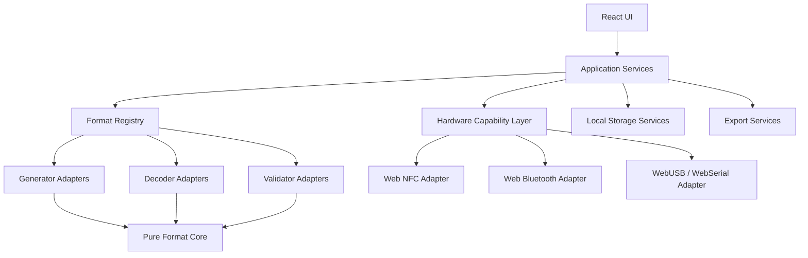

# Technical Architecture

## 1. Deployment model

Use a static single-page application built with Vite, React and TypeScript. Deploy the generated `dist/` directory to GitHub Pages.

Why Vite rather than a server-oriented framework:
- GitHub Pages serves static assets and does not run server routes.
- Core generation, parsing and validation can run in the browser.
- A static build keeps hosting simple and inexpensive.
- Hardware APIs can be called from client-side modules after user interaction.

No backend is required for the initial product.

## 2. High-level architecture



## 3. Suggested stack

- Vite
- React
- TypeScript with strict mode
- React Router or a lightweight route solution
- Tailwind CSS, with a small token layer
- Zod for input schemas where useful
- Vitest for unit tests
- Playwright for browser-level tests
- Web Workers for expensive image processing where needed
- IndexedDB for local history and larger user preferences

Library selection is a separate engineering task. Check maintenance, bundle size, supported formats, licence and known security issues before adding a dependency. Do not assume a library supports every variant merely because its name mentions QR or barcode.

## 4. Folder structure

```text
universal-code-studio/
├── public/
│   ├── icons/
│   └── samples/
├── src/
│   ├── app/
│   │   ├── App.tsx
│   │   ├── router.tsx
│   │   └── providers/
│   ├── components/
│   │   ├── layout/
│   │   ├── forms/
│   │   ├── feedback/
│   │   └── code-preview/
│   ├── modules/
│   │   ├── qr/
│   │   ├── barcode/
│   │   ├── two-dimensional/
│   │   ├── nfc/
│   │   ├── rfid/
│   │   ├── smart-card/
│   │   ├── gs1/
│   │   ├── encoding/
│   │   ├── wireless/
│   │   └── document-reading/
│   ├── core/
│   │   ├── registry/
│   │   ├── capabilities/
│   │   ├── errors/
│   │   ├── validation/
│   │   └── types/
│   ├── services/
│   │   ├── camera/
│   │   ├── hardware/
│   │   ├── storage/
│   │   └── export/
│   ├── workers/
│   ├── hooks/
│   ├── styles/
│   ├── utils/
│   └── main.tsx
├── tests/
│   ├── fixtures/
│   ├── integration/
│   └── e2e/
├── docs/
├── .agent/
│   ├── rules/
│   └── workflows/
├── AGENTS.md
├── index.html
├── vite.config.ts
├── package.json
└── README.md
```

## 5. Module contract

Each format module should expose a small, consistent interface. Do not make UI components call third-party libraries directly.

```ts
export type Operation = "generate" | "decode" | "validate" | "inspect";

export interface FormatCapability {
  id: string;
  label: string;
  category: string;
  operations: Operation[];
  support: "browser" | "limited" | "hardware" | "research";
  requirements?: string[];
}

export interface FormatAdapter<Input = unknown, Output = unknown> {
  capability: FormatCapability;
  generate?: (input: Input) => Promise<Output>;
  decode?: (input: Input) => Promise<Output>;
  validate?: (input: Input) => Promise<ValidationResult>;
  inspect?: (input: Input) => Promise<Output>;
}

export interface ValidationIssue {
  code: string;
  message: string;
  field?: string;
}

export interface ValidationResult {
  valid: boolean;
  issues: ValidationIssue[];
}
```

Use more specific types inside each module. The generic interface is a registry boundary, not permission to use `any`.

## 6. Registry

The registry is the single source of truth for tool discovery and capability display.

- Register only implemented adapters.
- Keep planned formats in metadata, but do not expose active controls for them.
- Each adapter declares operations and requirements.
- The UI reads support metadata to show correct badges and guidance.
- Hardware availability is evaluated at runtime and must not be hardcoded.

## 7. Hardware capability layer

Create a capability service that checks APIs without requesting access:

- `navigator.nfc` / `NDEFReader` availability.
- `navigator.bluetooth` availability.
- `navigator.usb` availability.
- `navigator.serial` availability.
- `navigator.mediaDevices?.getUserMedia` availability.
- Secure-context status.

Capability detection is not the same as device detection. The UI should say “API available” until the user connects a device and a real operation succeeds.

Request permissions only after the user presses a clearly labelled action. Do not request camera, NFC, Bluetooth, USB or serial access on page load.

## 8. Routing

Suggested routes:
- `/`
- `/generate/qr`
- `/generate/barcode`
- `/generate/2d`
- `/scan`
- `/decode`
- `/nfc`
- `/rfid`
- `/smart-card`
- `/gs1`
- `/convert`
- `/validate`
- `/settings`
- `/about`

Use a GitHub Pages-compatible router strategy. Configure Vite `base` for the repository path and test refresh/deep-link behaviour. A hash router is acceptable if it materially simplifies static hosting.

## 9. State and persistence

- Transient form state: React state.
- Preferences and small history: IndexedDB or localStorage.
- Large image data: keep in memory; avoid persistent storage unless user opts in.
- Do not persist raw scans by default.
- Provide Clear History and Clear Local Data actions.
- Version persisted data and handle schema changes safely.

## 10. Performance

- Lazy-load specialised modules.
- Lazy-load heavy decoder libraries.
- Process large images in a worker where possible.
- Revoke object URLs after use.
- Debounce expensive live previews.
- Set sensible file-size limits and show them before upload.
- Avoid loading every protocol library on the home page.

## 11. Error model

Use typed errors:
- `INVALID_INPUT`
- `UNSUPPORTED_FORMAT`
- `DECODE_FAILED`
- `PERMISSION_DENIED`
- `API_UNAVAILABLE`
- `DEVICE_NOT_FOUND`
- `DEVICE_DISCONNECTED`
- `HARDWARE_OPERATION_FAILED`
- `EXPORT_FAILED`
- `FILE_TOO_LARGE`

Map technical errors to plain language in the UI. Preserve diagnostic details in development logs, but never expose stack traces to ordinary users.
