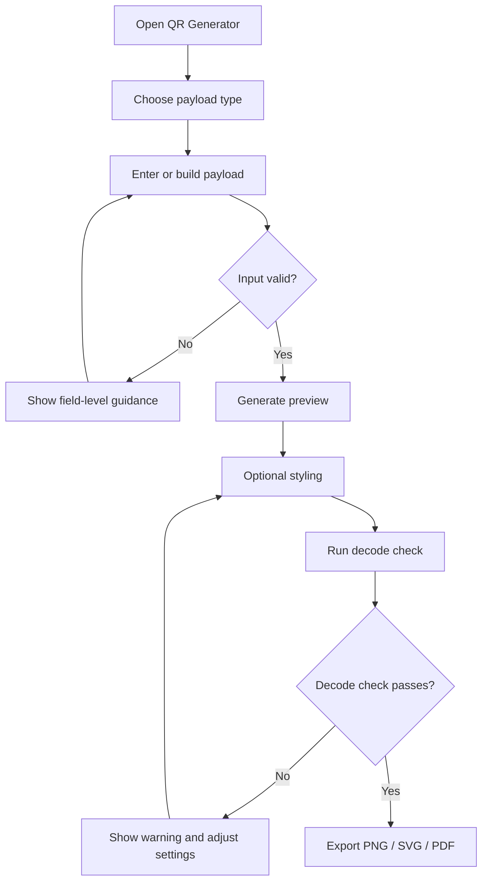

# User Flows

## 1. Home to tool

1. User opens the home page.
2. User chooses Generate, Scan, Decode, Convert or Validate.
3. User selects a specific format.
4. The tool page explains supported operations and requirements.
5. User enters data or selects a file.
6. User runs the operation.
7. Result appears with copy, download or inspect actions.

## 2. QR generation

## 3. Image scanner

1. User opens Scanner.
2. User chooses Upload Image or Camera.
3. For camera, explain permission and request only after button click.
4. User supplies image or grants camera permission.
5. Decoder scans supported formats.
6. Results show format, decoded value and any warnings.
7. User copies, downloads or clears the result.
8. Camera stream stops when the user exits or presses Stop.

## 4. NFC reader

1. User opens NFC Studio.
2. App checks whether the Web NFC API exists.
3. If unavailable, show a concise explanation and keep NDEF file/payload tools usable.
4. If available, user presses Read Tag.
5. App requests permission/starts scan.
6. On discovery, parse NDEF records.
7. Show decoded records and raw bytes.
8. User copies or exports results.
9. User stops scanning.

## 5. NFC writer

1. User builds an NDEF message.
2. App validates records and displays a final preview.
3. User presses Write to Tag.
4. Show a clear warning that a physical tag may be changed.
5. User confirms.
6. App starts the write operation.
7. Show success only after the API confirms completion.
8. If it fails, preserve the payload and explain the error.

## 6. RFID workflow

1. User chooses EPC Decoder or Physical Reader.
2. EPC Decoder accepts a pasted hex/binary EPC and works without hardware.
3. Physical Reader checks the selected adapter and browser APIs.
4. If no supported reader is connected, show the required hardware and supported connection method.
5. Once data arrives, show raw bytes and parsed fields.
6. Never show a fake scan result or simulated device response as real hardware output.

## 7. Batch generation

1. User downloads a sample CSV template.
2. User uploads a CSV.
3. App previews headers and first rows.
4. User maps the source column to the payload field.
5. App validates rows and reports invalid entries.
6. User chooses output format and layout.
7. App generates files in a worker if needed.
8. User downloads a ZIP or print sheet.

## 8. Error and unsupported states

Every tool needs:
- Empty state.
- Invalid input state.
- Processing state.
- Success state.
- Unsupported browser state, where relevant.
- Permission denied state, where relevant.
- Hardware disconnected state, where relevant.

Do not leave a user with a blank panel or a generic “Something went wrong” message.
